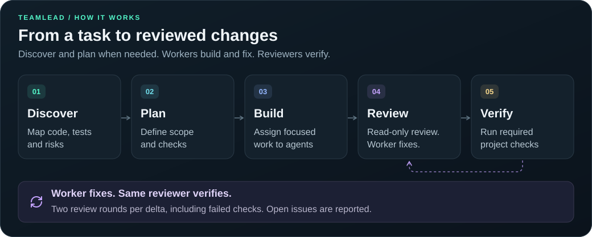

<p align="center">
  
</p>

<h1 align="center">teamlead</h1>

<p align="center">
  <strong>Delegate. Review by risk. Keep the context.</strong><br>
  One skill for Codex and Claude Code.
</p>

<p align="center">
  <a href="README.ru.md"></a>
</p>

<p align="center">
  <a href="skills/teamlead/references/codex/workflow.md"></a>
  <a href="skills/teamlead/references/claude/workflow.md"></a>
  <a href="#install"></a>
</p>

<p align="center">
  <a href="#install">Install</a> &nbsp;·&nbsp;
  <a href="#how-it-works">How it works</a> &nbsp;·&nbsp;
  <a href="#use">Usage</a> &nbsp;·&nbsp;
  <a href="#codex-models">Codex models</a> &nbsp;·&nbsp;
  <a href="#claude-code-models">Claude Code models</a>
</p>

---

Give Teamlead a task. It delegates scoped work, uses independent review when the risk calls for it, and reports what actually passed. Version **1.1.0** brings the same persistent workflow to Codex and Claude Code with updated model routing.

## Install

Requires Git and Node.js 22.20+ with npm. Run in your terminal:

```sh
npx skills add BorzDev/teamlead
```

**Applications → Global / Project → install.** The wizard includes the `Universal` group with Codex; select Claude Code as well if needed.

<details>
<summary><strong>How the installation wizard works</strong></summary>

The [Skills CLI](https://github.com/vercel-labs/skills) wizard handles installation:

1. Finds the single `teamlead` skill and selects it automatically.
2. Includes `Universal` applications, including Codex, automatically. Add Claude Code with Space and confirm with Enter. The application step may be skipped when only one application is detected.
3. Offers `Project` for the current project or `Global` for all of the user's projects.
4. May offer `Symlink / Copy`, then shows a summary for confirmation.

For a project installation, run the command from the project root. No GitHub login or manual clone is needed. The profile is selected when the skill runs, so you can install for both applications at once.

For Claude Code only, specify the application explicitly:

```sh
npx skills add BorzDev/teamlead -a claude-code
```

| Environment | Global (default path) | Project | Invocation |
| --- | --- | --- | --- |
| Codex | `~/.agents/skills/teamlead/` | `.agents/skills/teamlead/` | `$teamlead <task>` |
| Claude Code | `~/.claude/skills/teamlead/` | `.claude/skills/teamlead/` | `/teamlead <task>` |

Symlink mode shares one skill copy between applications. The application list comes from Skills CLI; this skill includes working profiles for Codex and Claude Code.

</details>

## How it works

<p align="center">
  
</p>

| Work | What happens |
| --- | --- |
| Simple, non-behavioral edits | Save the baseline, make the edit, run a focused check, inspect the diff. Up to three known files can be edited by the lead. |
| Unfamiliar code | One scout maps relevant files, contracts, tests, and risks. Known areas use targeted reading. |
| Complex tasks or planning only | Save a plan with file ownership, interfaces, risks, and checks. |
| Implementation | One helper at a time; parallel work requires your explicit request and separate files and resources. |
| Nontrivial changes | An independent reviewer reads the changes; the worker fixes findings. The same reviewer verifies the fix. |
| Completion | The lead runs required project checks in sequence and reports results, accepted risks, and anything unresolved. |

Review is limited to **two started rounds per delta**, including failed launches and reviews after final checks. Fixes do not reset that budget. A clean first review can finish immediately; otherwise the second checks the fixes. Open findings at the limit are reported for escalation. Reviewers never edit project files.

The mode stays active until you cancel it. `ready` closes the current task; it does not start another one or turn the mode off. A later request supplies the next task. Related work keeps its saved context, while a new delta gets its own checks and review budget. Plans, baseline snapshots, decisions, and reports survive context compaction outside the repository.

## Use

One entry point, two application profiles. The bundled instructions are in Russian. Run in a Git repository with at least one commit.

**Codex:** select **Astra / Ultra**, then send:

```text
$teamlead Add search filters and verify the result
```

**Claude Code:** select **Fable 5.1 / max**, then send:

```text
/teamlead Add search filters and verify the result
```

To start a Claude Code session with that lead:

```sh
claude --model claude-fable-5-1 --effort max
```

Append `только план` or `plan only` to stop after planning. A later “implement it” continues the plan. Tell the assistant to stop Teamlead mode when finished.

### Codex models

| Role | Model | Effort |
| --- | --- | --- |
| Lead: planning and decisions | `gpt-6-astra` | `ultra` |
| Narrow searches and mechanical edits | `gpt-6-luna` | `medium` |
| Scouting unfamiliar code; implementation | `gpt-6.1-sol` | `high` |
| Independent review | `gpt-6.1-sol` | `high` |
| Money, authorization, complex migrations, concurrency: implementation and review | `gpt-6.1-sol` | `xhigh` |
| Escalation of an individual blocked subtask | `gpt-6-astra` | `ultra` |

Requires `collaboration` with per-agent model/effort selection. New agents use `fork_turns: "none"` and explicit settings; related work resumes the appropriate agent. Availability depends on your account and runtime. The skill does not switch the main session or silently substitute models. Sources: [Codex models](https://learn.chatgpt.com/docs/models), [GPT-6.1 Sol](https://developers.openai.com/api/docs/models/gpt-6.1-sol). Full rules: [Codex profile](skills/teamlead/references/codex/workflow.md).

### Claude Code models

Requires **Claude Code 2.1.292+**, native `Agent` and `SendMessage`, and access to the requested models and effort levels. Per-invocation effort is supported from that version; see [Claude Code subagents](https://code.claude.com/docs/en/sub-agents).

| Role | Model | Effort |
| --- | --- | --- |
| Lead: planning and decisions | Fable 5.1 (`claude-fable-5-1`) | `max` |
| Narrow searches and mechanical edits | `haiku` — Haiku 5.5 | `high` |
| Scouting; implementation to a specification; small, low-risk reviews | `sonnet` — Sonnet 5.5 | `high` |
| Implementation with design choices; high-risk work; shared or central logic reviews | `opus` — Opus 5.5 | `high` |
| Escalation after Opus cannot resolve a clarified subtask | `fable` — Fable 5.1 | `high` |

Every helper uses the built-in `general-purpose` type with explicit `model`, `effort: "high"`, and `run_in_background: false`. No custom agent definitions or Dynamic workflows are required. The same reviewer checks worker fixes through `SendMessage`. The lead runs already specified check commands directly.

Aliases follow the current model generation; the versions above were checked on **2026-10-12** against [Anthropic's model catalog](https://platform.claude.com/docs/en/models/overview). Provider limits and environment overrides can affect settings. Requested settings are reported separately from runtime-confirmed settings. Full rules: [Claude Code profile](skills/teamlead/references/claude/workflow.md).

Start a new Claude Code session after installation. Reload the Codex session if it still shows the previous skill. Invocation is explicit in both environments; once invoked, the mode lasts until canceled.

## Updates and older versions

Repeat the install command and choose the applications and scope. Back up local edits first: installation replaces the existing `teamlead` files. Version 1.1 removes the old Workflow templates; reinstall the whole skill so stale references are not retained. Existing custom Claude agents are not changed or required.

Older `teamlead-codex` and `teamlead-claude` installations are not removed automatically. The shared commands are `$teamlead` and `/teamlead`. Release details: [changelog](CHANGELOG.md).

## Repository layout

```text
skills/teamlead/
  SKILL.md
  agents/openai.yaml
  references/
    state.md
    codex/
      workflow.md
      briefs.md
    claude/
      workflow.md
      briefs.md
```

Supporting paths resolve from the installation, including project installs and symlinks. Reports live outside the project, under `${CODEX_HOME:-$HOME/.codex}/teamlead/` or `~/.claude/teamlead/`, separated by checkout and task.

## Verification

Run `node --test tests/*.test.mjs` in a clone. Tests check the portable skill bundle, internal references, invocation examples, and release version. They do not execute live Codex or Claude agents. The old simulated Workflow tests were removed with the unused templates.
