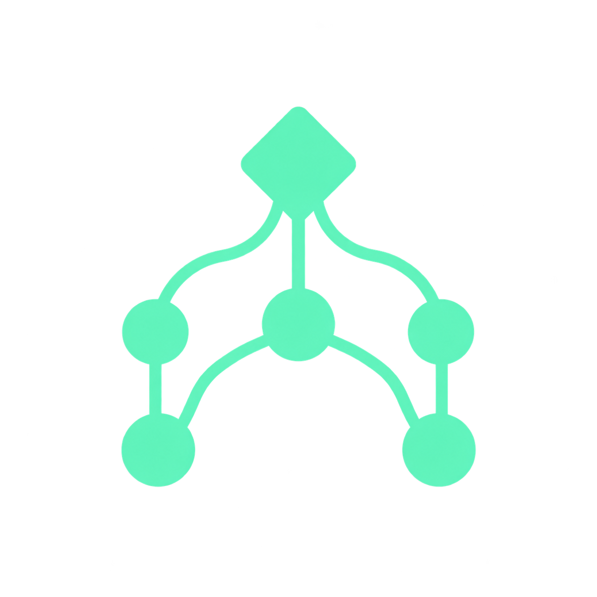
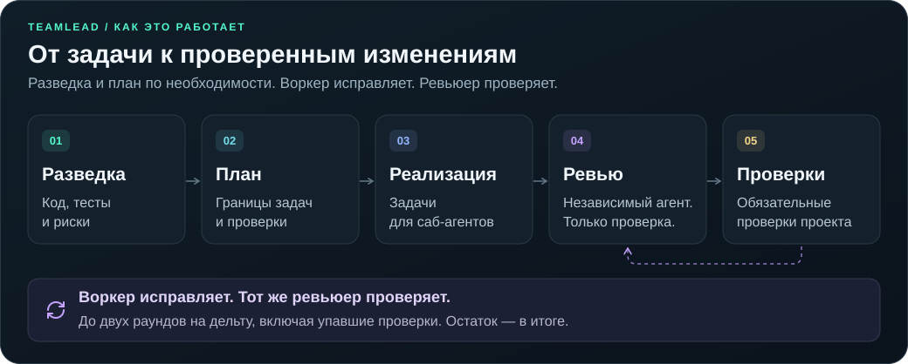

<p align="center">
  
</p>

<h1 align="center">teamlead</h1>

<p align="center">
  <strong>Делегирование. Ревью по риску. Сохранение контекста.</strong><br>
  Один навык для Codex и Claude Code.
</p>

<p align="center">
  <a href="README.md"></a>
</p>

<p align="center">
  <a href="skills/teamlead/references/codex/workflow.md"></a>
  <a href="skills/teamlead/references/claude/workflow.md"></a>
  <a href="#установка"></a>
</p>

<p align="center">
  <a href="#установка">Установка</a> &nbsp;·&nbsp;
  <a href="#как-это-работает">Как это работает</a> &nbsp;·&nbsp;
  <a href="#использование">Использование</a> &nbsp;·&nbsp;
  <a href="#модели-codex">Модели Codex</a> &nbsp;·&nbsp;
  <a href="#модели-claude-code">Модели Claude Code</a>
</p>

---

Дайте Teamlead задачу. Тимлид распределит работу, назначит независимое ревью по риску и отчитается о фактических проверках. В версии **1.1.0** обе среды получили единый режим до отмены и обновлённый выбор моделей.

## Установка

Нужны Git и Node.js 22.20 или новее с npm. Запустите в терминале:

```sh
npx skills add BorzDev/teamlead
```

**Приложения → Global / Project → установка.** Мастер включает группу `Universal` с Codex; при необходимости отметьте также Claude Code.

<details>
<summary><strong>Как работает мастер установки</strong></summary>

Мастер [Skills CLI](https://github.com/vercel-labs/skills) проведёт через установку:

1. Найдёт единственный навык `teamlead` и выберет его автоматически.
2. Автоматически включает приложения `Universal`, в том числе Codex. Добавьте Claude Code пробелом и подтвердите Enter. Если обнаружено только одно приложение, этот шаг может пропускаться.
3. Предложит `Project` — только текущий проект, или `Global` — все проекты пользователя.
4. При необходимости предложит `Symlink / Copy`, затем покажет итог для подтверждения.

Для установки в проект запускайте команду из его корня. Вход в GitHub и ручное клонирование не нужны. Профиль выбирается при запуске навыка, поэтому обе среды можно отметить за одну установку.

Для установки только в Claude Code укажите приложение явно:

```sh
npx skills add BorzDev/teamlead -a claude-code
```

| Среда | Global (путь по умолчанию) | Project | Вызов |
| --- | --- | --- | --- |
| Codex | `~/.agents/skills/teamlead/` | `.agents/skills/teamlead/` | `$teamlead <задача>` |
| Claude Code | `~/.claude/skills/teamlead/` | `.claude/skills/teamlead/` | `/teamlead <задача>` |

В режиме Symlink приложения используют общую копию навыка. Список приложений задаёт Skills CLI; этот навык содержит рабочие профили для Codex и Claude Code.

</details>

## Как это работает

<p align="center">
  
</p>

| Работа | Что происходит |
| --- | --- |
| Простые правки без изменения поведения | Исходный снимок, правка, адресная проверка, просмотр diff. До трёх известных файлов тимлид может поправить сам. |
| Незнакомый код | Один разведчик ищет файлы, контракты, тесты и риски. Для знакомой области достаточно адресного чтения. |
| Сложная задача или «только план» | План с владельцами файлов, интерфейсами, рисками и проверками. |
| Реализация | Один помощник за раз. Параллель — по прямой просьбе пользователя и на отдельных файлах и ресурсах. |
| Непростые изменения | Независимый ревьюер проверяет; воркер исправляет находки; тот же ревьюер проверяет исправления. |
| Завершение | Тимлид последовательно запускает обязательные проверки и перечисляет результаты, принятые риски и остаток. |

Предел — **два начатых раунда ревью на дельту**, включая сорванные запуски и ревью после финальных проверок. Исправления не обнуляют счётчик. Чистого первого раунда достаточно; иначе второй проверяет исправления. Если лимит исчерпан, открытые находки выносятся на решение об эскалации. Ревьюер не правит проект.

Режим действует до отмены. `ready` закрывает задание, не выключает навык и не запускает новую работу. Следующий запрос задаёт пользователь. Связанное продолжение сохраняет контекст; новая дельта получает свои проверки и лимит ревью. Планы, исходные снимки, решения и отчёты хранятся вне репозитория и переживают компакцию.

## Использование

Одна точка входа, два профиля среды. Инструкции навыка написаны на русском. Нужен Git-репозиторий хотя бы с одним коммитом.

**Codex:** выберите **Astra / Ultra** и отправьте:

```text
$teamlead Добавь поиск с фильтрами и проверь результат
```

**Claude Code:** выберите **Fable 5.1 / max** и отправьте:

```text
/teamlead Добавь поиск с фильтрами и проверь результат
```

Для новой сессии Claude Code с таким тимлидом:

```sh
claude --model claude-fable-5-1 --effort max
```

Добавьте `только план` или `plan only`, чтобы остановиться после плана. Позднее «выполняй» продолжит его. Для выхода явно попросите выключить режим Teamlead.

### Модели Codex

| Роль | Модель | Effort |
| --- | --- | --- |
| Тимлид: планирование и решения | `gpt-6-astra` | `ultra` |
| Узкий поиск и механические правки | `gpt-6-luna` | `medium` |
| Разведка незнакомого кода; реализация | `gpt-6.1-sol` | `high` |
| Независимое ревью | `gpt-6.1-sol` | `high` |
| Деньги, права, сложные миграции, конкурентность: реализация и ревью | `gpt-6.1-sol` | `xhigh` |
| Эскалация отдельной заблокированной подзадачи | `gpt-6-astra` | `ultra` |

Нужны инструменты `collaboration` с выбором модели/effort. Новые агенты запускаются с `fork_turns: "none"` и явными настройками; связанную работу продолжает подходящий агент. Доступность зависит от аккаунта и среды. Навык не переключает основную сессию и не подменяет модели молча. Источники: [модели Codex](https://learn.chatgpt.com/docs/models), [GPT‑6.1 Sol](https://developers.openai.com/api/docs/models/gpt-6.1-sol). Полные правила: [профиль Codex](skills/teamlead/references/codex/workflow.md).

### Модели Claude Code

Нужны **Claude Code 2.1.292+**, штатные `Agent` и `SendMessage`, доступ к запрошенным моделям и effort. Начиная с этой версии effort можно передавать в конкретном вызове: [документация саб-агентов Claude Code](https://code.claude.com/docs/en/sub-agents).

| Роль | Модель | Effort |
| --- | --- | --- |
| Тимлид: планирование и решения | Fable 5.1 (`claude-fable-5-1`) | `max` |
| Узкий поиск и механические правки | `haiku` — Haiku 5.5 | `high` |
| Разведка; реализация по спецификации; небольшое ревью с низким риском | `sonnet` — Sonnet 5.5 | `high` |
| Реализация с выбором решения; рискованные задачи; ревью общей или центральной логики | `opus` — Opus 5.5 | `high` |
| Эскалация, если Opus не закрыл уточнённую подзадачу | `fable` — Fable 5.1 | `high` |

Каждый помощник использует штатный тип `general-purpose` с явными `model`, `effort: "high"` и `run_in_background: false`. Отдельные определения агентов и Dynamic workflows не нужны. Исправления воркера проверяет тот же ревьюер через `SendMessage`. Готовые команды проверки тимлид запускает сам.

Алиасы следуют текущему поколению; версии выше сверены **12 октября 2026 года** с [каталогом Anthropic](https://platform.claude.com/docs/en/models/overview). Настройки провайдера и среды могут ограничить запрос. В итоге запрошенные параметры отделяются от подтверждённых runtime. Полные правила: [профиль Claude Code](skills/teamlead/references/claude/workflow.md).

После установки начните новую сессию Claude Code. Если Codex показывает прежний навык, перезагрузите сессию. Вызов явный в обеих средах; после вызова режим действует до отмены.

## Обновление и прежние версии

Повторите команду установки и выберите приложения и область. Сначала сохраните локальные правки: установка заменяет файлы `teamlead`. В версии 1.1 удалены старые Workflow-шаблоны; переустановите навык целиком, чтобы не оставить устаревшие ссылки. Имеющиеся пользовательские агенты Claude не меняются и не требуются.

Прежние `teamlead-codex` и `teamlead-claude` автоматически не удаляются. Общие команды — `$teamlead` и `/teamlead`. Изменения релиза: [changelog](CHANGELOG.md).

## Структура

```text
skills/teamlead/
  SKILL.md
  agents/openai.yaml
  references/
    state.md
    codex/
      workflow.md
      briefs.md
    claude/
      workflow.md
      briefs.md
```

Ссылки разрешаются относительно установки, включая Project и симлинки. Отчёты находятся вне проекта: `${CODEX_HOME:-$HOME/.codex}/teamlead/` или `~/.claude/teamlead/`, отдельно для каждого checkout и задачи.

## Проверка

Из клона запустите `node --test tests/*.test.mjs`. Тесты проверяют переносимость пакета, внутренние ссылки, примеры вызовов и версию релиза. Реальные агенты Codex и Claude не запускаются. Тесты старых Workflow-шаблонов удалены вместе с неиспользуемыми шаблонами.
